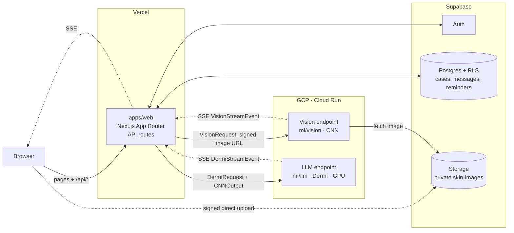

# DermiAI

A skin-health web app where users consult **Dermi**, an AI companion. Dermi combines:

1. a **CNN skin-condition classifier** (`ml/vision`) that turns a photo into ranked condition probabilities,
2. a **fine-tuned LLM** (`ml/llm`): domain-adapted on dermatology text (continued pretraining), then persona-tuned (SFT, DPO),
3. a **Next.js web app** (`apps/web`) on Vercel whose API routes handle auth, cases, reminders and report export, and proxy to both models.

> DermiAI is a final-year project, for education and decision support only. It is **not** a medical device and does not diagnose.

## Architecture



- **Vercel is the only backend the browser talks to.** The browser never calls the models. The models never call each
  other, and never touch the database. The CNN result reaches the LLM through the web app's `/api/consult` route.
- **One contract.** The Pydantic models in `packages/schemas` are exported to JSON Schema and generated as
  TypeScript (`@dermiai/schemas`). The model endpoints validate with Pydantic, and the web app type-checks against the generated types.
- **Images skip Vercel.** Browsers upload straight to Supabase Storage with a signed URL. The vision endpoint fetches
  the image with a short-lived signed download URL.

There's more detail, including the training and data flow, in [docs/architecture.md](docs/architecture.md).
The reasoning is in [ADR 0003](docs/decisions/0003-nextjs-supabase-vercel.md).

## Repo map

| Path | What | Owner |
|---|---|---|
| `apps/web/` | Next.js app + API routes (`src/app/api/*`), Supabase project (`supabase/`) | @Kunall04, @Hardik-1226 (all review) |
| `ml/vision/` | CNN classifier and its SSE endpoint: `src/`, `configs/`, `notebooks/`, `scripts/`, `tests/` | @palakbansal05 |
| `ml/llm/` | LLM pipeline `src/dermiai_llm/{data,persona,train,eval,serve}`, `configs/`, `scripts/`, `tests/` | @shvn22k |
| `packages/schemas/` | Shared contracts: Pydantic source → `jsonschema/` → generated `ts/` (`@dermiai/schemas`) | everyone |
| `data/` | Gitignored and DVC-tracked training data: `raw/` → `interim/` → `processed/` | |
| `infra/` | `docker/` model images, `gcp/` Cloud Run configs, `terraform/` (later) | |
| `docs/` | Architecture, data sources, experiment tracking, ADRs (`decisions/`), model cards | |
| `.github/` | Per-area CI, PR/issue templates, CODEOWNERS, Dependabot | |

## Setup

Prerequisites: [uv](https://docs.astral.sh/uv/) ≥ 0.6, Node ≥ 20.9, git. Docker is needed for local Supabase and model images. You'll also need gcloud for training data.

```bash
# one-time global tools (isolated, so they survive area-only syncs)
uv tool install rust-just
uv tool install pre-commit --with pre-commit-uv
uv tool install "dvc[gs]"

cp .env.example .env                          # ML side
cp apps/web/.env.example apps/web/.env.local  # web side

just setup                    # all Python areas + npm workspace + git hooks
#   or only your area:
just setup-web                # web owner: npm only, no Python
just setup-vision             # CNN teammate: no LLM / web deps
just setup-llm --extra train  # LLM work on a GPU box

just                          # list every command
just lint                     # all pre-commit hooks
just test                     # all Python tests
just db-start                 # local Supabase (Docker)
just web-dev                  # http://localhost:3000
```

## Top-level decisions

| Decision | Why |
|---|---|
| **Monorepo** ([ADR 0001](docs/decisions/0001-monorepo.md)) | Three components share contracts. One repo keeps a contract change and its consumers in a single PR. |
| **Next.js on Vercel as the only backend, Supabase for data** ([ADR 0003](docs/decisions/0003-nextjs-supabase-vercel.md)) | One TypeScript codebase for UI and API. Managed auth, Postgres with RLS, and storage replace a hand-built FastAPI service. GCP only runs what needs Python or a GPU. |
| **Models as streaming (SSE) HTTP endpoints on Cloud Run** | Token streaming for Dermi, and status events while a GPU cold-starts. Endpoint URLs come from env vars, so model and web deploys are independent. |
| **Contracts: Pydantic → JSON Schema → TypeScript** | Python is the source of truth because both model endpoints are Python. Generated files are committed and CI fails if they're stale. Supabase DB types are generated separately from migrations. |
| **uv workspace (Python) + npm workspace (TS)** | `uv sync --package dermiai-vision` installs only vision, and the web owner never needs Python. Heavy ML deps sit behind `--extra train`, so CI stays fast. |
| **`src/` layout with prefixed package names** (`dermiai_llm`, `dermiai_vision`) | Generic names like `data` or `train` would clash in one environment. |
| **Typed YAML configs** (`kind:` + Pydantic, unknown keys rejected) | Nothing tunable is hardcoded. Every config is validated in CI, and every step has `--dry-run`. |
| **DVC + GCS** for training data | Large and copyrighted files stay out of git. Each run maps to an exact data version. User images live only in Supabase. |
| **W&B** for tracking ([ADR 0002](docs/decisions/0002-experiment-tracking.md)) | Zero infrastructure and native HF/TRL integration. MLflow is the fallback if data residency is required. |
| **`justfile` instead of Makefile** | `make` isn't available on Windows by default, but `just` runs everywhere and installs with uv. |
| **Per-area CI with path filters**, plus one always-on `ci-repo` | Teammates aren't blocked by unrelated areas. Schema changes trigger every consumer. Secret and data checks always run. |
| **Secrets:** Vercel env (web), Secret Manager (models), `.env` / `.env.local` (local) | All are gitignored. gitleaks and `detect-private-key` run on every commit and PR, and server-only secrets never get a `NEXT_PUBLIC_` prefix. |

## Contributing

See [CONTRIBUTING.md](CONTRIBUTING.md): branch naming, Conventional Commits, PR checklist, adding an experiment, changing a contract.
