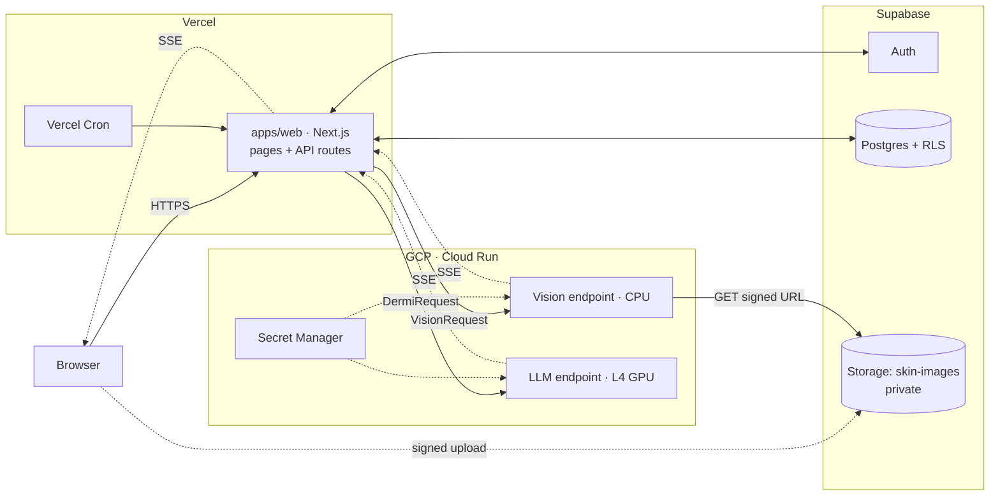
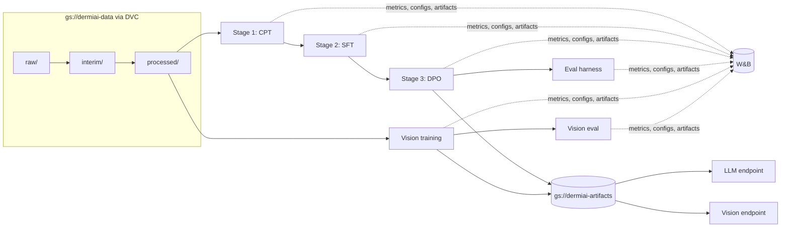

# Architecture

## Runtime

### Responsibilities

| Component | Owns | Never does |
|---|---|---|
| `apps/web` API routes (Vercel) | auth callbacks, cases, messages, reminders, report export, signed URLs, proxying + persisting model output | run models |
| Supabase | users/auth, Postgres (RLS on every table), private image storage | expose images publicly |
| Vision endpoint (`ml/vision`) | download image from signed URL → `CNNOutput` | store images, touch the DB |
| LLM endpoint (`ml/llm`) | `DermiRequest` → streamed reply + safety metadata | store conversations, touch the DB |

### Request flows

**Photo → classification**
1. `POST /api/uploads`: the route checks the session and returns a signed **upload** URL for `skin-images/<uid>/<case>/<uuid>.jpg`.
2. The browser uploads straight to Supabase Storage.
3. `POST /api/classify`: the route creates a 60-second signed **download** URL and POSTs a `VisionRequest` to `VISION_ENDPOINT_URL`.
4. The endpoint streams `status`* then `result` (a `CNNOutput`). The route validates each event, forwards it to the browser,
   and saves the `CNNOutput` on the case.

**Consultation**
1. `POST /api/consult`: the route loads the case history and latest `CNNOutput` from Postgres, then builds a `DermiRequest`.
2. The LLM endpoint streams `status`* (cold start), `delta`* (tokens), then `done` (a `DermiResponse` with `escalate_to_clinician`
   and `safety_flags`) or `error`.
3. The route passes the stream through to the browser and saves the final message when `done` arrives.

### Contract and streaming protocol

- Transport: `POST` JSON, response `Content-Type: text/event-stream`, one `data: <json>\n\n` per event.
- Event types: `VisionStreamEvent` / `DermiStreamEvent` in `packages/schemas`. These are discriminated unions on `type`.
- Every stream ends with exactly one terminal event (`result`/`done` or `error`).
- Auth from Vercel to the endpoints is described in `infra/gcp/README.md` (`bearer` for now, `gcp-oidc` as the target).
- The web route treats model output as untrusted. It validates each event, and the browser never sees raw upstream errors.

### Safety and privacy

- **The CNN is decision support, not diagnosis.** The LLM is trained and evaluated to frame CNN output that way and to escalate.
- User images and conversations are health data. They live only in Supabase (EU region, RLS) and are never used for training
  without a separate consent flow and ADR.
- Signed URLs are short-lived and per object. Model services keep no images after they respond.

## Training / data flow

## Open decisions (to become ADRs)

- Base LLM choice and licence. Serving stack (vLLM vs. HF TGI vs. a custom FastAPI loop).
- CNN on CPU vs. GPU Cloud Run (latency vs. cost).
- Report export format: server-rendered PDF vs. print-optimised page.
- Reminder channel: email (provider TBD) vs. web push.
- Supabase region and data retention policy.
